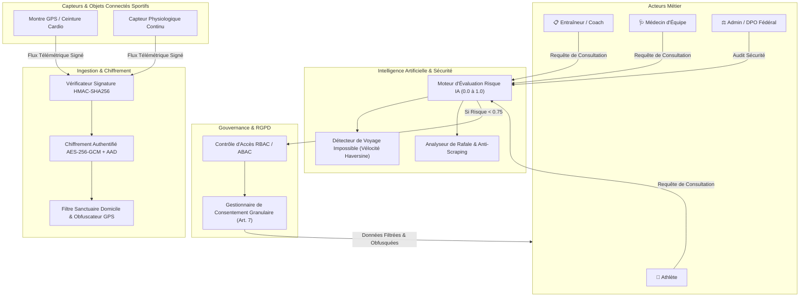

# Architecture Système - Protection des Données Biométriques des Athlètes

## 1. Vue d'Ensemble & Paradigme Zero-Trust

La plateforme de collecte et de traitement des données biométriques des sportifs de haut niveau est construite sur un modèle Zero-Trust et respecte les préconisations strictes de la CNIL et du RGPD (Article 9 sur les catégories particulières de données et directives EDPB sur la géolocalisation sportive).

## 2. Principes Fondamentaux de Sécurité & Privacy

### 2.1 Chiffrement Authentifié AES-256-GCM avec AAD
Toute donnée biométrique (fréquence cardiaque, variabilité HRV, puissance, cadence, lactatémie) est chiffrée symétriquement avant écriture. L'identifiant `athlete_id` est injecté en tant que *Donnée Associée Authentifiée (AAD)*, empêchant formellement toute tentative de substitution d'enregistrement d'un athlète à un autre.

### 2.2 Confidentialité Géographique & Protection Spatiale (GPS Privacy)
- **Détection des Zones Sanctuaires :** Le domicile privé et les lieux de repos de l'athlète font l'objet d'un géorepérage d'exclusion (sanctuary geofencing) où le suivi est automatiquement désactivé.
- **Floutage de Grille Spatiale (Grid Snap) :** La précision décimale est tronquée pour les entraîneurs et analystes (2 décimales ~1 km de floutage), suffisant pour valider les conditions climatiques et d'altitude, sans révéler le parcours urbain précis.

### 2.3 Variante IA : Détection d'Accès Anormaux
Le moteur d'IA évalue chaque demande d'accès selon un vecteur multi-dimensionnel :
- **Voyage Géographiquement Impossible :** Détection d'accès simultanés ou successifs impossibles sur le plan de la physique relativiste (vitesse de déplacement > 900 km/h calculée par distance de Haversine).
- **Rafale / Exfiltration Massive :** Détection d'aspirations automatisées de télémétrie (> 15 requêtes/min).
- **Accès Hors Horaires :** Accès nocturne injustifié par le staff technique (1h - 5h locales).
- **Score de Risque Unifié :** Au-delà du seuil de 0.75, la requête est immédiatement verrouillée (HTTP 403) et une alerte de sécurité scellée est transmise à l'administrateur fédération / DPO.
